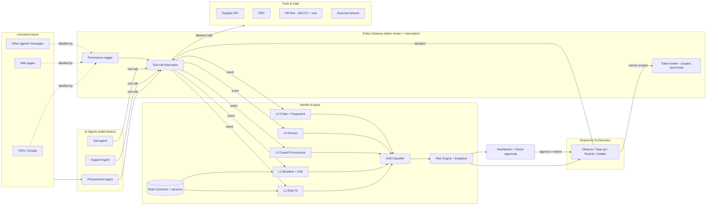
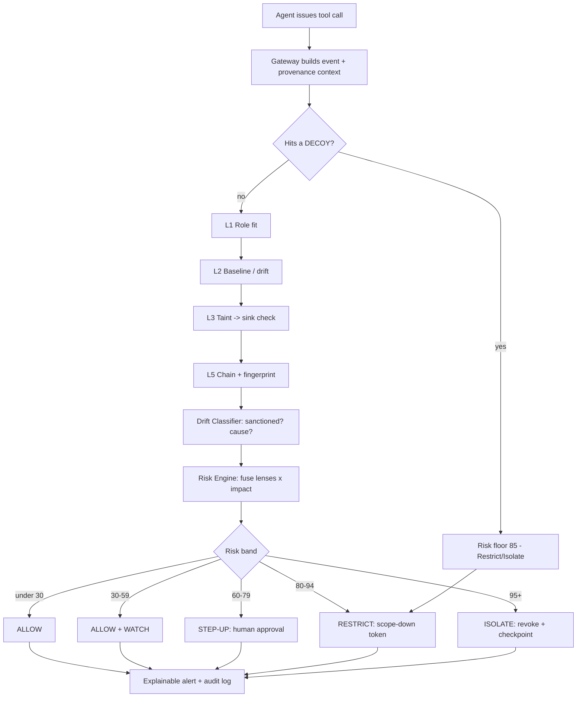
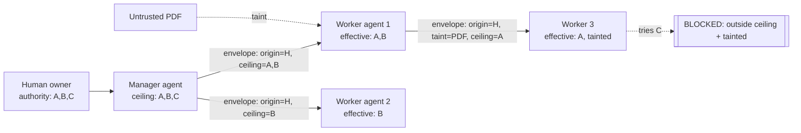
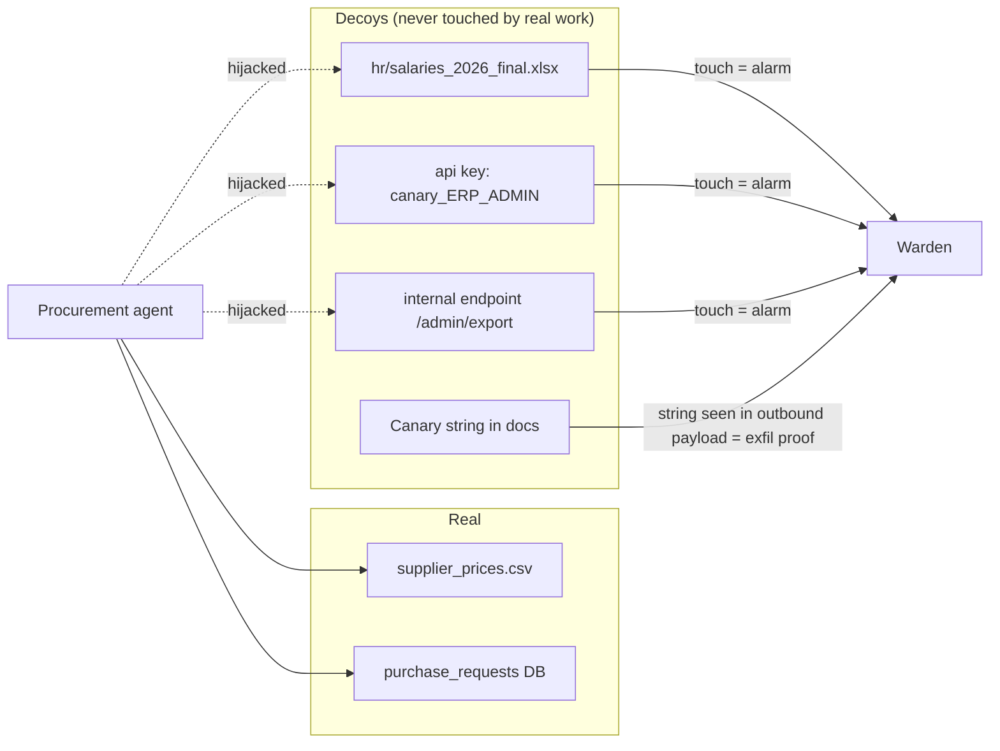
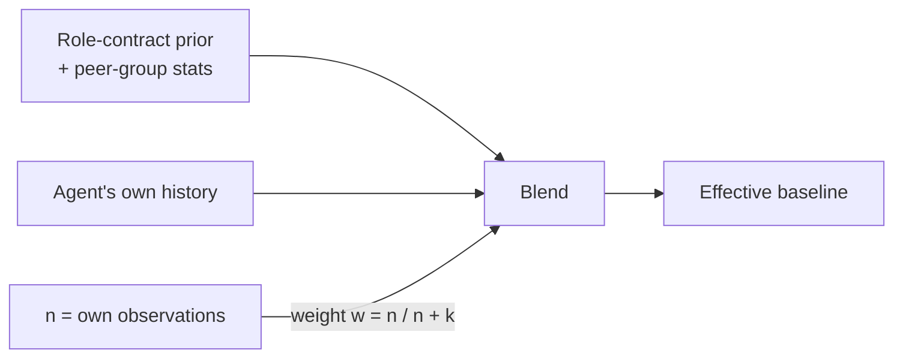

# 04 – Architecture

> Diagrams are in Mermaid (render at mermaid.live, GitHub, or VS Code preview). For slides, redraw the **High-level** and **Decision flow** diagrams in Figma/Canva/draw.io with your theme colors.

---

## 1. High-level architecture

---

## 2. Per-action decision flow

---

## 3. Delegation chain with authority attenuation

Rules: **effective permission = intersection of role contract, parent ceiling, and current scope**; **taint is inherited and never silently cleaned**; risk of a child contributes to the parent (contagion) and vice versa.

---

## 4. Decoy placement

---

## 5. Cold-start: Bayesian blend

`w` starts at 0 (all prior, Day-0) and increases as the agent builds history; a new agent is judged mostly by **its role + its peers**.

---

## 6. Data model (core tables)

| Table | Key fields |
|---|---|
| `agents` | agent_id, owner, role, role_version, parent_id, status, token_scope, created_at |
| `role_contracts` | role, version, yaml, signed_by, created_at |
| `events` | id, ts, agent_id, tool, resource, resource_class, sensitivity, destination, bytes, taint_labels[], parent_chain[], decision |
| `baselines` | agent_id/role, version, transition_matrix, feature_stats, anchor_frozen_at |
| `alerts` | id, ts, agent_id, risk, band, lens_scores{}, reasons[], evidence_event_ids[], owasp_tags[], action_taken, status |
| `change_declarations` | id, agent_id/role, type(task/tool/contract), approved_by, valid_from, valid_to |
| `decoys` | id, type, location, owner_role_scope, created_at, hits |
| `delegations` | id, from_agent, to_agent, ceiling, taint_labels[], ts |

---

## 7. Technology choices (24-hour friendly)

| Layer | Choice | Why |
|---|---|---|
| Backend | Python 3.11 + FastAPI | Fast to build; async; WebSocket for live feed |
| Storage | SQLite (prototype) → Postgres; in-memory Redis optional | Zero setup |
| ML | scikit-learn (Isolation Forest), numpy, own Markov/CUSUM code | Small, explainable |
| Semantic role-fit | sentence-transformers *or* TF-IDF fallback | Works offline |
| Graph | networkx | Chain & contagion |
| Frontend | React + Vite + Tailwind + Recharts + react-flow (graph) | Quick, good-looking |
| Agents for demo | Scripted simulators + optional real LLM agent (any API) | Reliable demo + proof of realism |
| Packaging | Docker Compose | One command to run |

---

## 8. Integration story (for feasibility slide)
- **Today (prototype):** SDK wrapper / HTTP proxy in front of tools.
- **Production:** MCP gateway plugin + OAuth token-exchange broker + OpenTelemetry GenAI spans ingestion + SPIFFE IDs. No change to the agent's model; only the tool-call path is routed through the gateway.
